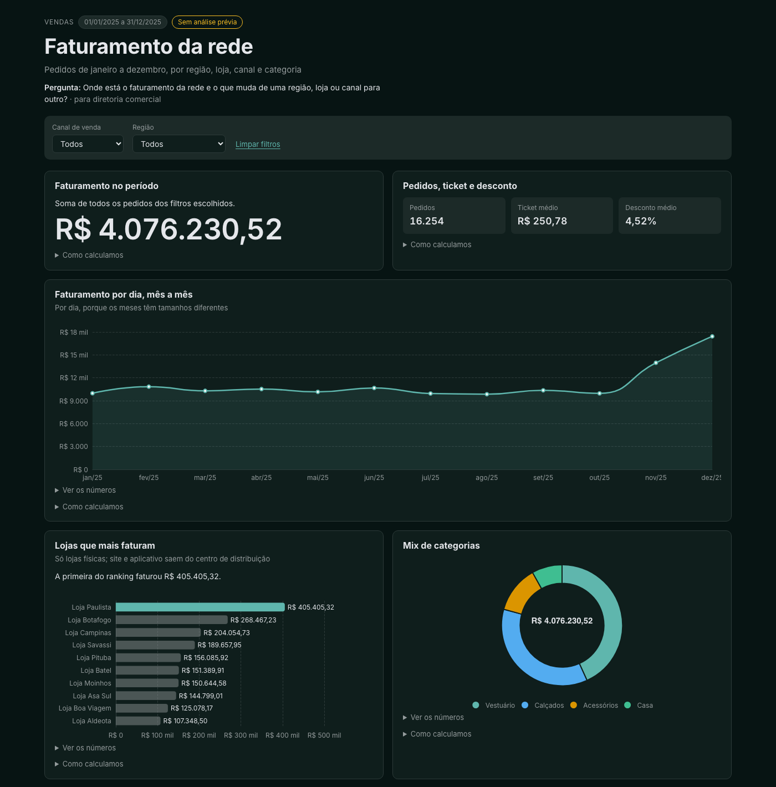
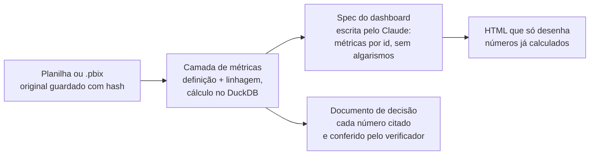
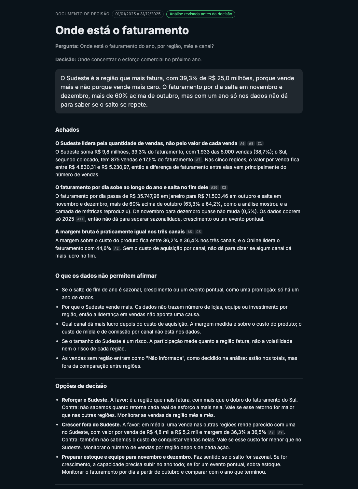

# Business Intelligence Report Builder

**Dashboards e documentos de decisão em HTML em que nenhum número sai do modelo de linguagem.**
O Claude desenha a página e escreve o texto; cada valor vem de uma camada de métricas
determinística, e um verificador recusa o que não tiver origem rastreada.

> **In English:** a Claude Code plugin that turns a spreadsheet, a data analysis or a Power BI
> `.pbix` into an HTML dashboard and a decision memo. The LLM never writes a number: every value
> comes from a deterministic metrics layer (DuckDB) served over MCP, and is checked before it ships.

**[Ver a demonstração ao vivo](https://fernandofigueiredo-data.github.io/business-intelligence-report-builder/)** ·
[Resultados](#resultados) · [Como funciona](#como-funciona) · [Limites conhecidos](#limites-conhecidos) ·
[Instalar](#instalar-e-rodar)



## O problema

Pedir a um modelo de linguagem um relatório a partir de uma planilha é rápido, mas o resultado
mistura número calculado com número plausível. Num documento que vai para a diretoria, um
percentual inventado tem a mesma cara de um percentual certo, e quem lê não tem como distinguir.

Este projeto separa os dois papéis: o modelo decide **o que mostrar e como escrever**; uma camada
de métricas decide **quanto vale**. Cada número do dashboard e do texto aponta para a métrica que
o calculou, e o documento só é gerado quando 100% dos números têm origem.

## Resultados

| O que foi testado | Resultado | Prova |
|---|---|---|
| Documento de decisão do exemplo completo: todo número do texto conferido contra os achados calculados | **26 de 26** números rastreados | [vitrine](https://fernandofigueiredo-data.github.io/business-intelligence-report-builder/ciclo/decisao.html) |
| Assistente de perguntas no dashboard publicado, contra 30 perguntas de resposta conhecida (3 sem resposta no dashboard) | **30 de 30** corretas; **0** respostas com número fora do que consultou | [`provas/f10/RESULTADO.md`](provas/f10/RESULTADO.md) |
| Conversão de três `.pbix` reais: medidas DAX traduzidas, testadas contra o motor do Power BI | Todas as traduzidas bateram (**13 de 13** e **17 de 17**); linhas das tabelas idênticas | [`provas/f7/RESULTADO.md`](provas/f7/RESULTADO.md) |
| Conversão do `.pbix` fictício, publicado no Power BI e posto ao lado do convertido | **10 de 11** medidas batem; a que não bateu aparece marcada "(não validada)" | [`provas/f7b/`](provas/f7b/RESULTADO.md) |
| Caso real privado (eleições presidenciais, 340.702 linhas), fluxo completo sem publicar | Documento com **25 de 25** números rastreados e **11 problemas** do próprio plugin documentados | [`provas/f8/ISSUES.md`](provas/f8/ISSUES.md) |

Todos os resultados acima são gerados por scripts (`provas/*/executar.py` e `registrar.py`) e
conferidos pelos 202 testes automatizados.

## Como funciona



Decisões de projeto que sustentam a garantia:

- **Um único caminho para números.** Só as ferramentas do servidor MCP `bi-dados`
  ([`servidor.py`](plugins/bi-html/mcp/servidor.py)) calculam; o modelo recebe o valor já
  formatado (`R$ 1.234,56`, `12,3%`) e o repete.
- **A spec não tem onde guardar um valor.** O [schema](plugins/bi-html/schemas/dashboard-spec.schema.json)
  não tem campo para números e recusa algarismos nos textos; um valor entra como marcador
  `{id_da_metrica}`.
- **O texto é auditado depois de escrito.** O [verificador](plugins/bi-html/lib/bi_html/verificador.py)
  extrai cada número do documento e procura sua origem nos achados, comparando com o valor sem
  arredondar (arredondar o que já foi arredondado aceitaria `17,496% → 18%`).
- **Medida do Power BI só conta depois do teste.** Cada medida DAX traduzida é calculada nos dois
  motores, em vários contextos de filtro; a que não bate fica marcada, a que não traduz fica de fora
  com o motivo.
- **Dados pessoais não saem.** Arquivo com CPF, e-mail ou telefone é detectado no perfil e não é
  publicado nem exportado.

## Demonstrações

O site estático em `docs/` tem quatro dashboards com dados fictícios (vendas, mídia paga, DRE e o
ciclo completo), o documento de decisão e a comparação com o Power BI.

| Documento de decisão | Power BI original ao lado do convertido |
|---|---|
|  |  |

## Limites conhecidos

- **Coluna no grão errado ainda passa sem alerta.** No caso real, colunas da zona eleitoral repetidas
  em cada linha de candidato foram somadas e inflaram o total. É o problema mais grave encontrado e
  está descrito, com a proposta de correção, em [`provas/f8/ISSUES.md`](provas/f8/ISSUES.md).
- **Uma tabela por modelo.** O fluxo a partir de planilha ainda não junta fato e dimensões.
- **`.pbix` só em modo de importação.** DirectQuery e conexão dinâmica são recusados com o motivo.
- **Datas e anos no texto do assistente** não passam pelo verificador de valores.

## Instalar e rodar

Requer o [Claude Code](https://code.claude.com) e o [`uv`](https://docs.astral.sh/uv/).

```bash
claude plugin marketplace add fernandofigueiredo-data/business-intelligence-report-builder
```

```bash
claude plugin install bi-html@bi-html
```

No Claude Code, `/bi-html:ciclo` diz em que etapa a pasta do projeto está e qual é o próximo passo.

| Comando | O que faz |
|---|---|
| `/bi-html:ingerir` | Lê CSV, Excel ou texto colado; perfil com tipos, datas e dados pessoais |
| `/bi-html:metricas` | Propõe e valida o modelo de métricas (`modelo/metricas.yaml`) |
| `/bi-html:design` | Aplica um design system enviado (DESIGN.md, tema do Power BI, CSS) ou infere um, com contraste AA |
| `/bi-html:dashboard` | Escreve a spec, valida e renderiza o dashboard |
| `/bi-html:decisao` | Gera achados, escreve o documento de decisão e o verifica |
| `/bi-html:pbix` · `/bi-html:comparar` | Converte um `.pbix` e monta a página ao lado do original |
| `/bi-html:assistente` · `/bi-html:exportar` | Dashboard com perguntas em linguagem natural; cópia em HTML que abre sem internet |

A etapa de análise é do plugin [`analise-dados`](https://github.com/fernandofigueiredo-data/analise-dados-plugin);
o contrato entre os dois está em [`CONTRATO.md`](plugins/bi-html/CONTRATO.md).

Testes (Python 3.12):

```bash
uv run --no-project --python 3.12 --with jsonschema --with "mcp>=2.3,<3" --with duckdb --with openpyxl --with pyyaml -m unittest discover -s tests -v
```

Gerar a vitrine de novo:

```bash
uv run --no-project --python 3.12 --with duckdb --with openpyxl --with pyyaml --with jsonschema vitrine/construir.py
```

## Estrutura

```text
plugins/bi-html/
  lib/bi_html/     lógica: ingestão, métricas, consulta, render, verificador, conversão DAX
  mcp/servidor.py  servidor MCP bi-dados, único caminho para números
  commands/        comandos do Claude Code
  schemas/         schema da spec de dashboard
tests/             202 testes, um arquivo por fase do plano
fixtures/          dados fictícios gerados com semente fixa (fixtures/gerar.py)
exemplos/          specs e modelos dos quatro exemplos
provas/            provas de conceito com resultados gerados por script
docs/              vitrine estática (gerada por vitrine/construir.py)
```

Stack: Python 3.12, DuckDB, MCP, JSON Schema, ECharts, Claude Code.

## Documentação

- [`PLANO_DE_CONSTRUCAO.md`](PLANO_DE_CONSTRUCAO.md): fases, critérios de aceite, riscos e decisões,
  com cada afirmação marcada como fato verificado, inferência ou hipótese.
- [`REGRAS.md`](plugins/bi-html/REGRAS.md): as regras que o plugin impõe em toda sessão.
- [`fixtures/README.md`](fixtures/README.md): o que cada conjunto de dados fictício exercita.

## Licença

MIT.
